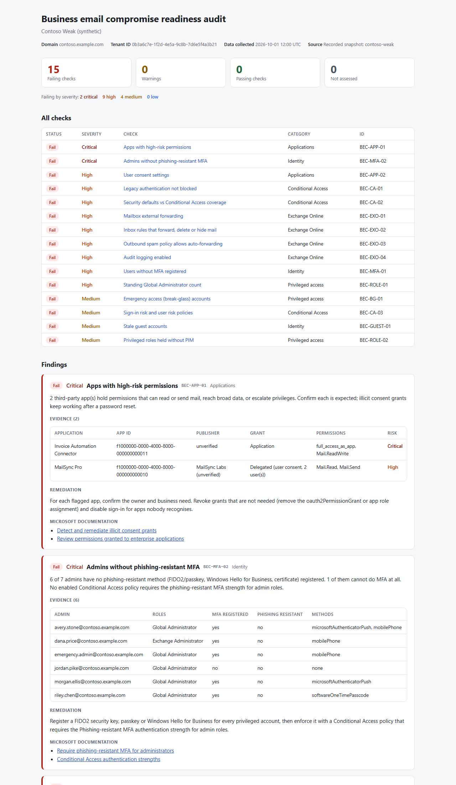

# M365 BEC Audit

A read-only PowerShell audit of a Microsoft 365 / Entra ID tenant for the weaknesses that business email compromise (BEC) relies on: missing MFA, legacy authentication, mail forwarding, attacker-style inbox rules, over-permissioned OAuth apps, standing admin access and weak emergency access.

It reads the tenant through Microsoft Graph (GET requests with four read-only delegated scopes) and Exchange Online (`Get-*` cmdlets only). It writes a console summary, a self-contained HTML report and a JSON document. Every finding carries a severity, the evidence behind it, remediation steps and links to the Microsoft documentation for the fix.



More screenshots: [mixed-result tenant](docs/report-contoso-basic.png), [dark mode](docs/report-contoso-weak-dark.png).

## Checks

| ID | Severity | Check | Fails when |
|---|---|---|---|
| BEC-MFA-01 | High | Users without MFA registered | An enabled member account has no MFA method registered. |
| BEC-MFA-02 | High (Critical if an admin has no MFA at all) | Admins without phishing-resistant MFA | A privileged role holder (active or PIM-eligible) has no FIDO2/passkey, Windows Hello for Business or certificate method. Warns if all do but no Conditional Access policy enforces the Phishing-resistant MFA strength. |
| BEC-CA-01 | High | Legacy authentication not blocked | Security defaults are off and no enforced CA policy blocks Exchange ActiveSync and other legacy clients for all users and apps. Report-only or partially scoped blocks warn. |
| BEC-CA-02 | High (Critical with no MFA enforcement at all) | Security defaults vs Conditional Access coverage | Security defaults are off and no enforced, unconditional CA policy requires MFA for all users on all apps. Exclusions beyond the break-glass accounts warn. |
| BEC-CA-03 | Medium | Sign-in risk and user risk policies | No CA policy acts on sign-in risk or user risk. Covering only one, or only in report-only mode, warns. |
| BEC-EXO-01 | High | Mailbox external forwarding | A mailbox has `ForwardingSmtpAddress` set to a domain outside the accepted domains. Forwarding to a recipient object warns. |
| BEC-EXO-02 | High | Inbox rules that forward, delete or hide mail | An enabled rule (hidden rules included) forwards or redirects externally, or moves mail to RSS Feeds / Conversation History / Archive and marks it read, or deletes or hides mail matching finance keywords. Plain delete or hide rules warn. |
| BEC-EXO-03 | High | Outbound spam policy allows auto-forwarding | The default outbound spam policy has `AutoForwardingMode` On. `Automatic`, or a custom policy turning it On for some senders, warns. Remote-domain settings are shown as context. |
| BEC-EXO-04 | High | Audit logging enabled | `UnifiedAuditLogIngestionEnabled` is false, or mailbox auditing is disabled organisation-wide. |
| BEC-APP-01 | High (Critical for app-only escalation or full mailbox access) | Apps with high-risk permissions | A third-party service principal holds a mail, broad-data or privilege-escalation permission on Microsoft Graph or Exchange Online, as an application permission or a delegated grant. Microsoft first-party apps are excluded. |
| BEC-APP-02 | High | User consent settings | Users can consent to any app (`microsoft-user-default-legacy`). Custom consent policies warn. |
| BEC-ROLE-01 | High | Standing Global Administrator count | More than four principals hold Global Administrator permanently (Microsoft recommends fewer than five). Fewer than two active Global Administrators warns. |
| BEC-ROLE-02 | Medium | Privileged roles held without PIM | A privileged role is assigned permanently instead of eligible through PIM. Emergency access accounts holding Global Administrator are exempt. |
| BEC-GUEST-01 | Medium | Stale guest accounts | An enabled guest has not signed in for 90 days, never signed in, or has not accepted an invitation sent more than 30 days ago. |
| BEC-BG-01 | Medium | Emergency access (break-glass) accounts | No emergency access account is found, or one is synced from on-premises, outside `*.onmicrosoft.com`, not permanently active Global Administrator, lacks a phishing-resistant method, or is subject to an enforced CA policy. |

Statuses are `Pass`, `Fail`, `Warn`, `NotAssessed` (the data the check needs could not be collected, with the reason) and `Error` (the check threw; the rest of the run continues).

## Try it without a tenant

Requires Windows PowerShell 5.1 or PowerShell 7.

```powershell
Import-Module .\src\M365BecAudit\M365BecAudit.psd1
Invoke-M365BecAudit -FixturePath .\fixtures\contoso-weak -OutputPath .\out
```

Three synthetic tenants are included. Every name, address and identifier in them is invented, and all domains are on the reserved `example.com`, `example.net` and `example.org` names.

| Fixture | What it is | Result |
|---|---|---|
| `fixtures/contoso-weak` | No baseline MFA, disabled legacy-auth block, external forwarding, a hide-the-invoice inbox rule, an unverified app with `full_access_as_app`, five permanent Global Admins, a synced break-glass account | 15 of 15 checks fail |
| `fixtures/contoso-hardened` | CA baseline, phishing-resistant admins, PIM, two cloud-only break-glass accounts, forwarding off, audit on | 15 of 15 pass |
| `fixtures/contoso-basic` | Small tenant on security defaults with no Entra ID P1/P2: no sign-in activity, no PIM data, inbox rules skipped | Mixed, including `Warn` and `NotAssessed` |

## Design

```
                 +-------------------+
  live tenant -->|  Live collector   |--+
                 +-------------------+  |     +-----------+     +----------+     +------------------+
                                        +---->| Snapshot  |---->|  Checks  |---->| console/HTML/JSON|
                 +-------------------+  |     +-----------+     +----------+     +------------------+
  JSON files --->| Fixture collector |--+
                 +-------------------+
```

- **Dataset catalog** (`Private/DatasetCatalog.ps1`): every dataset the audit reads, the Graph endpoint or Exchange cmdlet behind it, the least-privileged permission Microsoft documents for it, and the fetch code. The Connect scopes, the permission table below and the read-only tests are all driven from it.
- **Collectors** (`Private/Collectors.ps1`) implement one small contract: `Kind`, `Skip`, `ReadMeta` and `ReadDataset`. The live collector calls Graph and Exchange Online; the fixture collector reads `<dataset>.json` files in Graph's own `{"value": [...]}` shape. Any object with those members works, which is how the tests inject in-memory tenants.
- **Snapshot**: datasets plus a table of collection errors. A dataset that fails to collect (no licence, no permission, skipped) is recorded with its reason, and only the checks that need it become `NotAssessed`.
- **Checks** (`Private/Checks/*.ps1`) are pure functions of the snapshot. They make no network calls, so all of them run against fixtures.
- **Record and replay**: `Save-M365BecAuditSnapshot` writes a live collection in the fixture format, and `-FixturePath` replays it offline. A recording of a real tenant contains real names and grants: keep it out of source control (`recordings/` is git-ignored).

## Permissions

### Microsoft Graph

`Connect-M365BecAudit` requests exactly these delegated scopes, all read-only, with a process-scoped session:

`AuditLog.Read.All`, `Directory.Read.All`, `Policy.Read.All`, `RoleManagement.Read.Directory`

The per-dataset view (`Get-M365BecAuditPermission -Detailed`). "Least privileged" is the permission Microsoft documents for that call; "Requested" is the scope in the list above that covers it. `Directory.Read.All` is the documented least-privileged permission for listing OAuth2 permission grants, and it also covers users, organization and service principals, so the narrower `User.Read.All` and `Application.Read.All` would add nothing. `RoleManagement.Read.Directory` likewise covers both PIM schedule endpoints.

| Dataset | Source | Request | Least privileged | Requested |
|---|---|---|---|---|
| `organization` | Graph | `GET /v1.0/organization` | Organization.Read.All | Directory.Read.All |
| `users` | Graph | `GET /v1.0/users` (with `signInActivity`) | User.Read.All + AuditLog.Read.All (signInActivity) | Directory.Read.All, AuditLog.Read.All |
| `userRegistrationDetails` | Graph | `GET /v1.0/reports/authenticationMethods/userRegistrationDetails` | AuditLog.Read.All | AuditLog.Read.All |
| `conditionalAccessPolicies` | Graph | `GET /v1.0/identity/conditionalAccess/policies` | Policy.Read.All | Policy.Read.All |
| `securityDefaults` | Graph | `GET /v1.0/policies/identitySecurityDefaultsEnforcementPolicy` | Policy.Read.All | Policy.Read.All |
| `authorizationPolicy` | Graph | `GET /v1.0/policies/authorizationPolicy` | Policy.Read.All | Policy.Read.All |
| `adminConsentRequestPolicy` | Graph | `GET /v1.0/policies/adminConsentRequestPolicy` | Policy.Read.All | Policy.Read.All |
| `roleAssignments` | Graph | `GET /v1.0/roleManagement/directory/roleAssignments` (filtered per privileged role, principal expanded) | RoleManagement.Read.Directory | RoleManagement.Read.Directory |
| `roleAssignmentScheduleInstances` | Graph | `GET /v1.0/roleManagement/directory/roleAssignmentScheduleInstances` | RoleAssignmentSchedule.Read.Directory | RoleManagement.Read.Directory |
| `roleEligibilityScheduleInstances` | Graph | `GET /v1.0/roleManagement/directory/roleEligibilityScheduleInstances` | RoleEligibilitySchedule.Read.Directory | RoleManagement.Read.Directory |
| `servicePrincipals` | Graph | `GET /v1.0/servicePrincipals` | Application.Read.All | Directory.Read.All |
| `resourceServicePrincipals` | Graph | `GET /v1.0/servicePrincipals?$filter=appId eq '<Microsoft Graph or Exchange Online>'` | Application.Read.All | Directory.Read.All |
| `appRoleAssignedTo` | Graph | `GET /v1.0/servicePrincipals/{resource-id}/appRoleAssignedTo` | Application.Read.All | Directory.Read.All |
| `oauth2PermissionGrants` | Graph | `GET /v1.0/oauth2PermissionGrants` | Directory.Read.All | Directory.Read.All |

Delegated access also depends on the signed-in account's Entra role. **Global Reader** is listed in Microsoft's documentation as a supported role for the Conditional Access, registration-details, OAuth-grant and PIM endpoints above, and is the role to use for the Graph side.

### Exchange Online

Exchange Online PowerShell has no scope model: the signed-in account's Exchange role decides what it can read. The audit only ever calls `Get-AcceptedDomain`, `Get-EXOMailbox`, `Get-InboxRule`, `Get-HostedOutboundSpamFilterPolicy`, `Get-HostedOutboundSpamFilterRule`, `Get-RemoteDomain`, `Get-AdminAuditLogConfig` and `Get-OrganizationConfig`, and a test fails the build if any other cmdlet appears in the collection code.

- Microsoft documents that `Get-InboxRule` **does not work** for the Global Reader role or the View-Only Organization Management role group. Inbox-rule collection therefore needs an Exchange role that includes `Get-InboxRule` (for example Exchange Administrator). If the auditing account does not have one, run with `-SkipInboxRules`; BEC-EXO-02 is then reported as not assessed and everything else still runs.
- To see which roles in your tenant grant a cmdlet: `Get-ManagementRoleEntry -Identity "*\Get-InboxRule"` ([Microsoft docs](https://learn.microsoft.com/en-us/powershell/exchange/find-exchange-cmdlet-permissions)).

### Licensing

| Data | Needs | Without it |
|---|---|---|
| `signInActivity` on users | Entra ID P1 or P2 | Stale-guest check falls back to creation date and invitation state, and says so |
| PIM schedule instances | Entra ID P2 | BEC-ROLE-02 not assessed; BEC-ROLE-01 treats every active Global Admin as standing |
| Risk-based CA policies | Entra ID P2 | BEC-CA-03 fails (no risk policy can exist) |

## Running against a real tenant

### 1. Get a test tenant (Microsoft 365 Developer Program)

The Developer Program's E5 sandbox is free, but Microsoft now limits it to qualifying members: holders of a Visual Studio Professional or Enterprise subscription, companies in the ISV Success Program or eligible tiers of the Microsoft AI Cloud Partner Program, and companies with a Premier or Unified Support contract. Setup also requires a Microsoft billing account for verification; Microsoft states that the sandbox itself is not charged. Check the current terms before starting: [Microsoft 365 Developer Program](https://learn.microsoft.com/en-us/office/developer-program/microsoft-365-developer-program) and its [FAQ](https://learn.microsoft.com/en-us/office/developer-program/microsoft-365-developer-program-faq). Only use a qualification path that belongs to you, not an employer's.

1. Go to the [Developer Program page](https://developer.microsoft.com/microsoft-365/dev-program) and choose **Sign in** with a Microsoft account (phone-number sign-ins and `*.onmicrosoft.com` addresses are not accepted). Choose **Join now**, enter contact email, country/region and company, accept the terms, choose **Next**, set your preferences and choose **Join**. Visual Studio subscribers should instead activate the benefit from [Visual Studio My Benefits](https://my.visualstudio.com/benefits).
2. On the Developer Program dashboard, choose **Set up E5 subscription**, then **Instant sandbox**, then **Next**.
3. Pick the data-centre country/region (it cannot be changed later) and select or create a billing account, then choose **Set up**.
4. Set the sandbox admin username and password. Record them somewhere safe; this account is a Global Administrator of the new tenant.
5. Wait for the dashboard to show the subscription as **Active** and note the `<name>.onmicrosoft.com` domain. If the sample data packs are not already installed, install **Users** first and then **Mail & events** from the dashboard; together they add 16 licensed sample users with mailboxes.
6. The subscription is issued for 90 days. Microsoft renews it automatically only while the tenant stays eligible and meets the renewal requirements; the dashboard shows the current status.

If you do not qualify, any other Microsoft 365 tenant you are allowed to audit works the same way (for example a Microsoft 365 Business Premium or E5 trial; Business Premium includes Entra ID P1 but not P2).

### 2. Make the tenant worth auditing (optional)

A fresh sandbox has few of the misconfigurations the audit looks for. In the sandbox only, you can stage some: create an inbox rule in a sample user's Outlook that moves messages containing "invoice" to RSS Feeds and marks them read; set an external forwarding address on a sample mailbox; grant consent to a test app; leave a sample user without MFA. Then run the audit and confirm each shows up.

### 3. Create a least-privilege auditing account

In the Microsoft Entra admin center, create a user in the sandbox (for example `auditor@<name>.onmicrosoft.com`) and assign it **Global Reader**. For inbox-rule collection, also assign a role that includes `Get-InboxRule` (see Exchange Online above), or plan to run with `-SkipInboxRules`.

### 4. Install the modules and run

```powershell
Install-Module Microsoft.Graph.Authentication -Scope CurrentUser
Install-Module ExchangeOnlineManagement -Scope CurrentUser

Import-Module .\src\M365BecAudit\M365BecAudit.psd1
Connect-M365BecAudit -TenantId <name>.onmicrosoft.com      # browser sign-in as the auditing account; consent to the four read-only scopes
Invoke-M365BecAudit -Live -OutputPath .\out -BreakGlassAccount bg1@<name>.onmicrosoft.com, bg2@<name>.onmicrosoft.com
```

`Connect-MgGraph` signs in through the Microsoft Graph Command Line Tools app, and all four scopes need admin consent. The first time, run `Connect-M365BecAudit` signed in as the sandbox Global Administrator and accept the prompt on behalf of the organisation; after that, the Global Reader account can sign in and run the audit.

Useful switches:

| Switch | Effect |
|---|---|
| `-SkipExchange` | Graph checks only; Exchange checks are reported as not assessed |
| `-SkipInboxRules` | Skip the per-mailbox `Get-InboxRule` loop |
| `-SaveSnapshotPath .\recordings\<date>` | Also record the collection for offline replay with `-FixturePath` |
| `-BreakGlassAccount <upn>...` | Name the emergency access accounts instead of matching `break glass` / `emergency` in names |
| `-StaleGuestDays`, `-MaxGlobalAdmins` | Thresholds (defaults 90 and 4) |
| `-PassThru` | Return the snapshot, findings and report paths |

Other commands: `Get-M365BecAuditCheck`, `Get-M365BecAuditPermission [-Detailed]`, `Get-M365BecAuditSnapshot`, `Invoke-M365BecAuditAnalysis`, `Export-M365BecAuditReport`, `Show-M365BecAuditSummary`, `Save-M365BecAuditSnapshot`. Each has comment-based help (`Get-Help Invoke-M365BecAudit -Full`).

## Tests and quality

```powershell
Install-Module Pester -MinimumVersion 5.5.0 -Scope CurrentUser -SkipPublisherCheck
Install-Module PSScriptAnalyzer -Scope CurrentUser
.\build.ps1                 # Pester suite + PSScriptAnalyzer
.\build.ps1 -Task Report    # render the three fixture reports into .\out
```

- 149 Pester tests: pass, fail and edge cases for every check against the fixtures; the fixture and in-memory collectors; save-and-replay round trips; the live Graph collector against a mocked `Invoke-MgGraphRequest` (GET-only, paging, the `signInActivity` fallback); the live Exchange collector against stand-in cmdlets; HTML encoding of attacker-controlled names; and the read-only guarantees (scopes, `-Method GET`, `Get-*` cmdlets only).
- PSScriptAnalyzer: zero findings at Error, Warning and Information severity, with the formatting rules enabled (`PSScriptAnalyzerSettings.psd1`).
- Every remediation link points at learn.microsoft.com and was checked to resolve.

## Limitations

- The live path is exercised through mocks and stand-in cmdlets; it has not yet been run against a real tenant.
- Group membership is not expanded: a role assigned to a group, or a CA exclusion by group, is reported as such rather than resolved to users.
- Emergency access accounts are found by `-BreakGlassAccount` or by name; the audit cannot know which accounts are emergency accounts otherwise.
- Mail flow (transport) rules, Defender for Office 365 policies, DMARC/SPF/DKIM and sign-in log analysis are out of scope.
- `Get-InboxRule` runs once per mailbox, so inbox-rule collection time grows with tenant size.

## Licence

MIT
